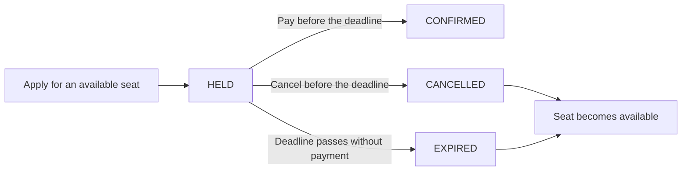

# School Admission System

A full-stack school admission application that manages limited seats on a first-come, first-served basis. Parents can temporarily reserve a seat, confirm admission through simulated payment, cancel an application, and track their application history. School administrators can create classes and monitor seat availability.

The main engineering focus is reliable seat allocation when many people apply at the same time, with automatic expiration of unpaid reservations.

## Technology Stack

| Layer | Technology |
| --- | --- |
| Backend | ASP.NET Core 8 / C# |
| Database access | Entity Framework Core + Npgsql |
| Database | PostgreSQL 16 |
| Frontend | React 18 + TypeScript + Vite |
| Deployment | Docker Compose; Nginx serves the frontend |
| Testing | xUnit, PostgreSQL Testcontainers, and Playwright |

## Project Workflow

1. **Create a class:** An administrator enters a class/shift name and its total seat capacity. Different shifts are separate classes with independent capacities.
2. **Identify the student:** A parent enters a 17-digit birth registration number. The browser remembers it for refresh recovery.
3. **Browse availability:** The class list shows total, held, confirmed, and available seats. Counts refresh automatically every five seconds.
4. **Apply:** If a seat is available and the student has no active application in that class, the backend creates a temporary seat hold.
5. **Complete the application:** The parent can select **Pay Fee** to simulate successful payment and confirm admission, or **Cancel application** to release the hold.
6. **Expire unpaid holds:** If the deadline passes, the background worker automatically expires the hold and makes the seat available again. No browser refresh or API request is needed to trigger cleanup.
7. **Review history:** **My applications** shows the student's active and previous applications, including confirmed, expired, and cancelled records.



An unpaid hold lasts **10 minutes by default**. Its duration can be configured with `HOLD_DURATION_SECONDS`.

## Key Engineering Strengths

- **Database-enforced allocation:** PostgreSQL transactions and class-row locks serialize seat decisions for the same class. Capacity checks and hold creation happen inside the same transaction.
- **Safe concurrent requests:** The production allocation path has been tested with 50 and 1,000 simultaneous requests for five seats, plus requests split across two independent backend processes sharing one database.
- **Automatic expiration:** A background worker checks overdue holds every two seconds. Confirmation also checks the deadline independently, so an expired hold cannot be paid just because cleanup has not run yet.
- **Consistent state transitions:** Ownership checks protect confirmation/cancellation, active duplicates are rejected, and repeated confirmation does not consume another seat.
- **UI updates without reload:** Seat counts and application history refresh every five seconds. Application details refresh every two seconds, with a countdown that updates every second. Expired actions are disabled automatically.
- **Persistent data:** Classes and applications remain stored in a named PostgreSQL volume across normal container restarts and Compose down/up.
- **Complete browser workflow:** Class creation, applying, simulated payment, cancellation, and history are available through the React UI, with visible loading, validation, conflict, and network-error states.

## Run Locally

### Prerequisite

Install and start **Docker Desktop with Docker Compose**. Running the application does not require local installations of .NET, Node.js, or PostgreSQL.

### 1. Open the application directory

Clone or download the repository, then open a terminal in the directory containing `docker-compose.yml`.

With the current repository layout, run this from the repository root:

```bash
cd School_Admission_System
```

If you are already inside that directory, skip this command. If you publish the application directory itself as your repository root, run the following commands directly there.

### 2. Start the services

```bash
docker compose up --build -d
```

Compose builds and starts PostgreSQL, the API, and the frontend. The API applies pending database migrations before accepting requests.

### 3. Open the application

| Service | Address |
| --- | --- |
| Web application | [http://localhost:3000](http://localhost:3000) |
| Backend API | [http://localhost:8080](http://localhost:8080) |
| Database readiness | [http://localhost:8080/health](http://localhost:8080/health) |

PostgreSQL is available inside the Docker network and is not exposed on a host port by default.

### 4. Try the workflow

1. Open **Create class (admin)** and create a new class with two seats, for example **Class 7 - Day Shift**.
2. Enter the dummy student ID **10000000000000000**.
3. Open **Classes**, select **Apply**, then select **Pay Fee**. The application becomes **CONFIRMED**.
4. Change the student ID to **10000000000000001**, apply to the same class, and select **Cancel application**. The available seat returns.
5. Apply again and leave the hold unpaid. After its deadline, the page shows **EXPIRED** and the seat becomes available without reloading.
6. Open **My applications** to review the selected student's history. Refresh the browser to verify that the student ID is retained.

### Logs and shutdown

```bash
docker compose ps
docker compose logs -f backend
docker compose down
```

Normal `docker compose down` keeps the named database volume. **Do not add `-v` when you want to preserve data.**

## Configuration

Defaults work without a `.env` file. To customize them, copy `.env.example` to `.env` once and edit the values. Keep `.env` out of Git.

| Variable | Purpose | Default |
| --- | --- | --- |
| `POSTGRES_DB` | PostgreSQL database name | `school_admission` |
| `POSTGRES_USER` | PostgreSQL application user | `schoolapp` |
| `POSTGRES_PASSWORD` | Database password | Local development example in `.env.example` |
| `HOLD_DURATION_SECONDS` | Duration assigned to new holds | `600` |
| `FRONTEND_ORIGIN` | Allowed browser origin | `http://localhost:3000` |
| `VITE_API_BASE_URL` | Browser-facing API address, set at build time | `http://localhost:8080` |

The API reads its connection string through `ConnectionStrings__Default`; Compose assembles it from the PostgreSQL settings. Rebuild the frontend after changing `VITE_API_BASE_URL`. Changing a hold duration affects new holds; existing holds keep their original deadlines.

## Testing

Previous verification on **11 November 2026** passed **66 backend tests** with none failed/skipped and **five browser scenarios**. Checks also covered actual Docker persistence, all eight API contracts, and concurrency across two backend processes. These are recorded results, not tests run automatically when the application starts.

To run backend tests, install a .NET SDK capable of targeting .NET 8 and keep Docker running. From the application directory:

```bash
dotnet test backend/SchoolAdmission.Tests/SchoolAdmission.Tests.csproj
```

Backend integration tests use disposable PostgreSQL containers.

For frontend checks, install Node.js 20+ and Chrome, keep the Compose services running, and run:

```bash
cd frontend
npm ci
npm run build
npm run test:e2e
```

Browser tests run against the development stack and create uniquely named dummy classes and applications. Their expiry scenario accelerates only its own test hold's deadline through PostgreSQL. The separate backend worker test verifies natural expiration without API traffic.

## Demo Scope

This application intentionally uses a student identifier instead of login authentication. Class creation is unauthenticated, and payment is simulated. Use synthetic student IDs when testing. The server independently validates ownership, status, deadlines, and capacity; the UI's disabled buttons are only a convenience.
